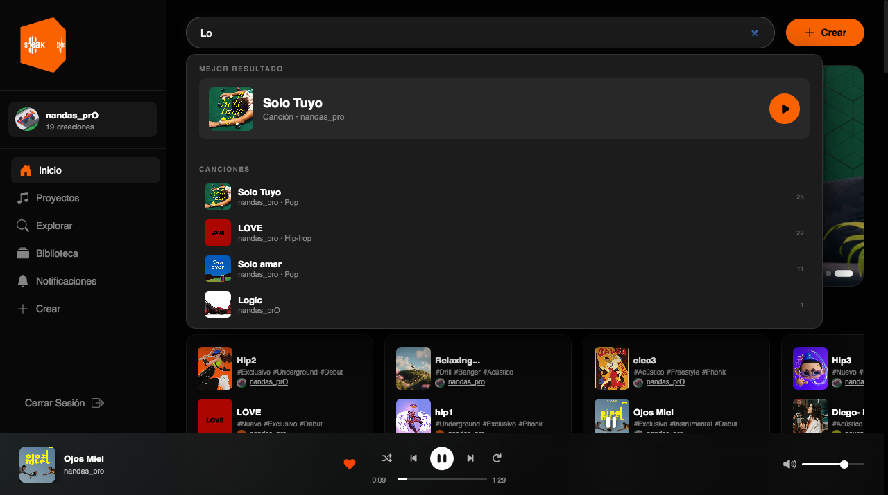
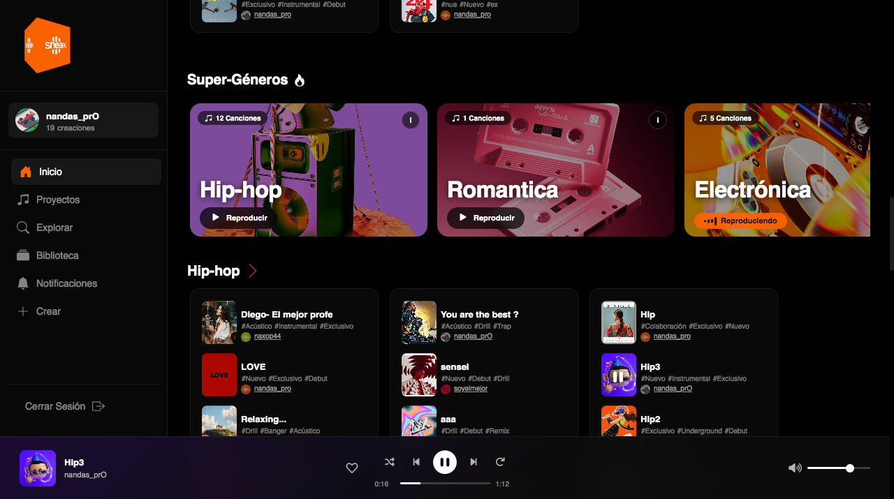
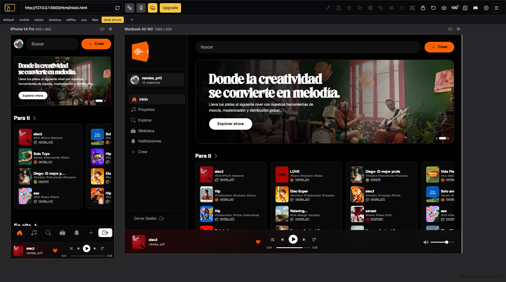

# 🎵 SNEAK STUDIO

# 🎵 Plataforma de Música Independiente

Plataforma de música independiente que permite explorar diferentes géneros musicales, crear listas de reproducción, escuchar música mediante un reproductor global y compartir proyectos musicales.

Desarrollada con **Node.js, Express, Firebase y Supabase**.

---

## 📸 Capturas de pantalla

### 🖥️ Vista principal
<p align="center">
  
</p>

### 🏠 Inicio y 🔎 Búsqueda
<p align="center">
  
  &nbsp;
  
</p>

### 🎧 Reproductor y 🎼 Proyectos
<p align="center">
  
  &nbsp;
  
</p>

### 📱 Diseño responsive
<p align="center">
  
</p>

---
# Guía de desarrollo y despliegue

## Estructura del proyecto

```
sneak-studio/
├── server.js                  ← Servidor Express (punto de entrada)
├── package.json
├── .env                       ← Variables de entorno (¡no subir a Git!)
├── .env.example               ← Plantilla del .env
├── .gitignore
│
├── src/                       ← Backend (Node.js/Express)
│   ├── routes/
│   │   ├── api.js             ← Router /api/*
│   │   ├── config.js          ← GET /config/client (config pública)
│   │   ├── supabaseProxy.js   ← GET /api/storage/*
│   │   └── health.js          ← GET /api/health
│   ├── middleware/
│   │   ├── errorHandler.js    ← Manejo centralizado de errores
│   │   ├── requestLogger.js   ← Log de peticiones
│   │   └── securityHeaders.js ← Cabeceras HTTP seguras
│   └── config/
│       ├── firebase.js        ← Config Firebase desde .env
│       └── supabase.js        ← Config Supabase desde .env
│
└── public/                    ← Frontend (servido estáticamente)
    ├── html/                  ← Páginas HTML
    ├── css/                   ← Estilos
    ├── js/
    │   ├── firebase-config.js ← ⭐ NUEVO: carga config del backend
    │   ├── firebase-auth.js   ← Auth (sin claves hardcodeadas)
    │   ├── sneak-db.js        ← DB (sin claves hardcodeadas)
    │   └── ...resto de JS
    └── fonts/
```

---

## ⚙️ Instalación en local

### 1. Clonar y preparar

```bash
git clone <tu-repositorio>
cd sneak-studio

# Instalar dependencias
npm install
```

### 2. Configurar variables de entorno

```bash
# Copiar la plantilla
cp .env.example .env

# Editar .env con tus valores reales
# (usa VS Code, nano, o cualquier editor)
nano .env
```

El archivo `.env` debe quedar así:

```env
PORT=3000
NODE_ENV=development

FIREBASE_API_KEY=AIzaSy...
FIREBASE_AUTH_DOMAIN=tu-proyecto.firebaseapp.com
FIREBASE_PROJECT_ID=tu-proyecto
FIREBASE_STORAGE_BUCKET=tu-proyecto.firebasestorage.app
FIREBASE_MESSAGING_SENDER_ID=123456789
FIREBASE_APP_ID=1:123456789:web:abc123

SUPABASE_URL=https://xxxx.supabase.co
SUPABASE_ANON_KEY=eyJhbGci...

RECAPTCHA_SITE_KEY=6Ldj5q...
```

### 3. Ejecutar

```bash
# Modo desarrollo (con recarga automática)
npm run dev

# Modo producción
npm start
```

Abre http://localhost:3000 en el navegador.

---

## 🔐 Cómo funciona la seguridad de las claves

### El flujo de configuración

```
Browser                  Express Server              .env
  │                           │                        │
  │── GET /config/client ────>│                        │
  │                           │── lee variables ──────>│
  │<── { firebase, supabase } │                        │
  │                           │                        │
  │ initializeApp(config)     │                        │
  │ (Firebase inicializa)     │                        │
```

1. El frontend **nunca tiene las claves en el código fuente**
2. Al cargar, pide la configuración al backend (`GET /config/client`)
3. El backend lee las variables del `.env` y las devuelve
4. El frontend inicializa Firebase con esa config

### ¿Por qué las claves de Firebase "pueden" ser públicas?

La `apiKey` de Firebase **no es un secreto de verdad** — está diseñada para ser visible. La seguridad real viene de:

- **Firestore Security Rules**: controlan quién puede leer/escribir qué
- **App Check + ReCaptcha**: verifica que las peticiones vienen de tu web
- **Firebase Auth**: solo usuarios autenticados acceden a datos protegidos

Aun así, moverlas al backend es correcto porque:
- No aparecen en el historial de Git
- Se pueden rotar sin tocar el código
- Facilitan los diferentes entornos (dev/prod)

---

## 🚀 Despliegue en producción

### Opción A: Render (recomendado para empezar)

1. **Crear cuenta** en [render.com](https://render.com)

2. **Nuevo servicio** → "Web Service" → conectar tu repositorio GitHub

3. **Configuración:**
   - Build Command: `npm install`
   - Start Command: `npm start`
   - Environment: `Node`

4. **Variables de entorno** (en "Environment"):
   ```
   NODE_ENV=production
   PORT=10000   ← Render usa este puerto
   FIREBASE_API_KEY=...
   FIREBASE_AUTH_DOMAIN=...
   FIREBASE_PROJECT_ID=...
   FIREBASE_STORAGE_BUCKET=...
   FIREBASE_MESSAGING_SENDER_ID=...
   FIREBASE_APP_ID=...
   SUPABASE_URL=...
   SUPABASE_ANON_KEY=...
   RECAPTCHA_SITE_KEY=...
   ```

5. **Deploy** → Render genera una URL tipo `https://sneak-studio.onrender.com`

> ⚠️ El plan gratuito de Render apaga el servidor tras 15min de inactividad.
> El primer request tarda ~30s en "despertar". Para producción real, usa el plan Starter ($7/mes).

---

### Opción B: Railway

1. **Instalar CLI:**
   ```bash
   npm install -g @railway/cli
   railway login
   ```

2. **Crear proyecto:**
   ```bash
   railway init
   railway link
   ```

3. **Configurar variables:**
   ```bash
   railway variables set NODE_ENV=production
   railway variables set FIREBASE_API_KEY=AIzaSy...
   railway variables set FIREBASE_PROJECT_ID=...
   # ... resto de variables
   ```

4. **Desplegar:**
   ```bash
   railway up
   ```

5. **Abrir en navegador:**
   ```bash
   railway open
   ```

---

### Opción C: VPS propio (más control)

Si tienes un servidor Ubuntu/Debian:

```bash
# Instalar Node.js 20
curl -fsSL https://deb.nodesource.com/setup_20.x | sudo -E bash -
sudo apt-get install -y nodejs

# Clonar proyecto
git clone <tu-repo>
cd sneak-studio
npm install

# Crear .env con las variables
nano .env

# Instalar PM2 (gestor de procesos)
npm install -g pm2

# Arrancar con PM2
pm2 start server.js --name sneak-studio
pm2 save
pm2 startup

# Ver logs
pm2 logs sneak-studio
```

---

## 📡 Endpoints de la API

| Método | Ruta | Descripción |
|--------|------|-------------|
| `GET` | `/` | Sirve el index.html |
| `GET` | `/config/client` | Config pública (Firebase + Supabase) |
| `GET` | `/api/` | Info de la API |
| `GET` | `/api/health` | Estado del servidor (útil para healthchecks) |
| `GET` | `/api/storage/list/:bucket` | Lista archivos de Supabase Storage |
| `GET` | `/api/storage/url/:bucket/*` | URL pública de un archivo |

---

## 🛠️ Comandos útiles

```bash
npm run dev          # Servidor con recarga automática (desarrollo)
npm start            # Servidor en producción

# Ver si el servidor responde:
curl http://localhost:3000/api/health

# Ver la config que devuelve al frontend:
curl http://localhost:3000/config/client | json_pp
```

---

## 🐛 Solución de problemas frecuentes

**"Cannot find module 'dotenv'"**
```bash
npm install
```

**"FIREBASE_API_KEY is not defined"**
→ Falta el archivo `.env`. Ejecuta `cp .env.example .env` y rellénalo.

**Las páginas HTML devuelven 404**
→ Comprueba que los archivos están en `public/html/` y que el servidor está corriendo.

**Firebase: "auth/invalid-api-key"**
→ La API key en `.env` es incorrecta o el endpoint `/config/client` falla.
→ Prueba: `curl http://localhost:3000/config/client`

**Supabase: upload falla**
→ Verifica que `SUPABASE_URL` y `SUPABASE_ANON_KEY` están bien en `.env`.
→ Comprueba que el bucket existe en el dashboard de Supabase.


GR